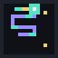
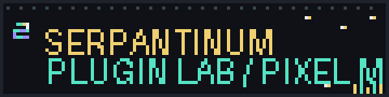
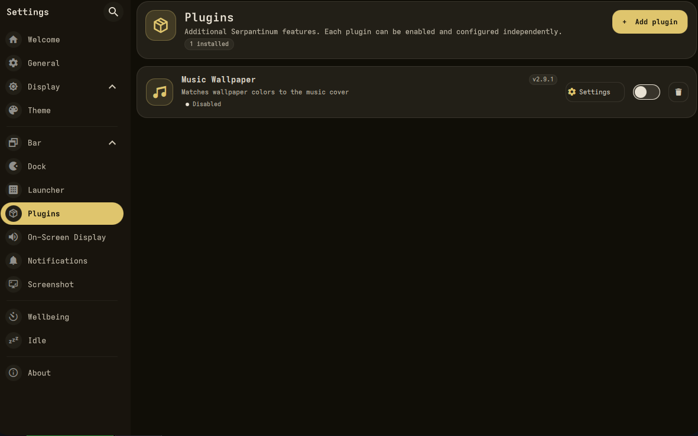
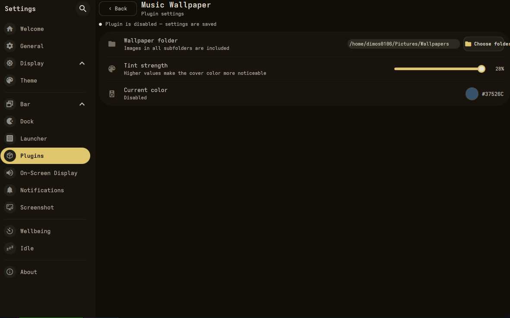
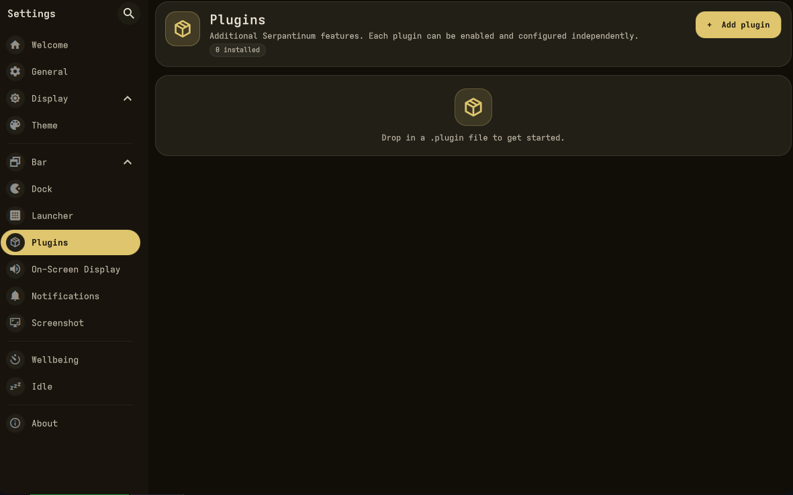

<div align="center">


<p>
  
  &nbsp;<strong>PIXEL PLUGIN ECOSYSTEM</strong>&nbsp;
  
</p>

<h1>Serpantinum Plugins</h1>

<p><strong>Make your desktop feel like your own.</strong><br>
Plugins, integrations, and little details that make Serpantinum more personal.</p>



<br>

<p>
  <a href="https://github.com/dimos0106-bot/SerpantinumPlugins/stargazers"></a>
  <a href="https://github.com/dimos0106-bot/SerpantinumPlugins/commits/main"></a>
  <a href="https://github.com/ilyamiro/serpantinum"></a>
  
</p>

<p>
  <a href="#-showcase">SHOWCASE</a> &nbsp; · &nbsp;
  <a href="#-plugin-lineup">PLUGINS</a> &nbsp; · &nbsp;
  <a href="#-quick-start">QUICK START</a> &nbsp; · &nbsp;
  <a href="#-contribute">CONTRIBUTE</a>
</p>

</div>


## ▣ Showcase

<div align="center">
  <h3>THE PLUGIN MANAGER</h3>
  
  <sub>One place to view your extensions and open their controls.</sub>
</div>

<br>

<table>
  <tr>
    <td width="50%" valign="top">
      
      <h4 align="center">01 — TUNE THE LOOK</h4>
      <p align="center"><sub>Choose a wallpaper folder and adjust tint strength.</sub></p>
    </td>
    <td width="50%" valign="top">
      
      <h4 align="center">02 — START CLEAN</h4>
      <p align="center"><sub>Add a plugin package and build your own setup.</sub></p>
    </td>
  </tr>
</table>

## ▣ Plugin lineup

<table>
  <tr>
    <td width="88" align="center" valign="top">
      
    </td>
    <td valign="top">
      <h3>Music Wallpaper</h3>
      <p><code>PERSONALISATION</code> &nbsp; <code>SERPANTINUM PLUGIN</code></p>
      Uses current media information to find artwork-related wallpaper matches and lets you tune a colour tint in the plugin settings.
      <p>
        
        
        
      </p>
      <p><a href="plugins/music-wallpaper/README.md"><strong>OPEN PLUGIN DOCUMENTATION →</strong></a></p>
    </td>
  </tr>
</table>

> The collection is evolving. Check each plugin's own README for its current version, compatibility, dependencies, installation steps, and known limitations.

## ▸ Quick start

### 1. Get the source

```bash
git clone https://github.com/dimos0106-bot/SerpantinumPlugins.git
cd SerpantinumPlugins
```

### 2. Pick your extension

Browse the `plugins/` folder, then read that plugin's README before installing it.

### 3. Follow its setup guide

Requirements can differ by extension. Keep a backup of relevant Serpantinum configuration before applying updates.

<div align="center">
  <br>
  
  <p><strong>BOOT SEQUENCE COMPLETE?</strong></p>
  <sub>Check the plugin guide before enabling it on your system.</sub>
</div>

## ◫ Repository map

```text
SerpantinumPlugins/
├── .github/
│   ├── ISSUE_TEMPLATE/
│   └── PULL_REQUEST_TEMPLATE.md
├── assets/
│   ├── serpantinum-logo.svg
│   ├── serpantinum-pixel-banner.gif
│   ├── serpantinum-pixel-loop.gif
│   └── Screenshot_*.png
├── plugins/
│   └── music-wallpaper/
│       └── README.md
├── CONTRIBUTING.md
└── README.md
```

## ⌘ Contribute

Want to report a bug or pitch an idea? Open an [issue](https://github.com/dimos0106-bot/SerpantinumPlugins/issues). For useful reports, include the plugin name, version, steps to reproduce, and relevant redacted logs.

Read [CONTRIBUTING.md](CONTRIBUTING.md) before sending changes. Never publish access tokens, private keys, or other sensitive data in issues or screenshots.

## ▤ License

No repository-wide licence has been selected yet. Unless a licence is added to this repository or a specific plugin, do not assume redistribution or reuse is permitted.

---

<div align="center">


<h3>STAY PIXEL. STAY PERSONAL.</h3>

<sub>Serpantinum Plugins · Built for a desktop that feels like yours.</sub>

</div>
