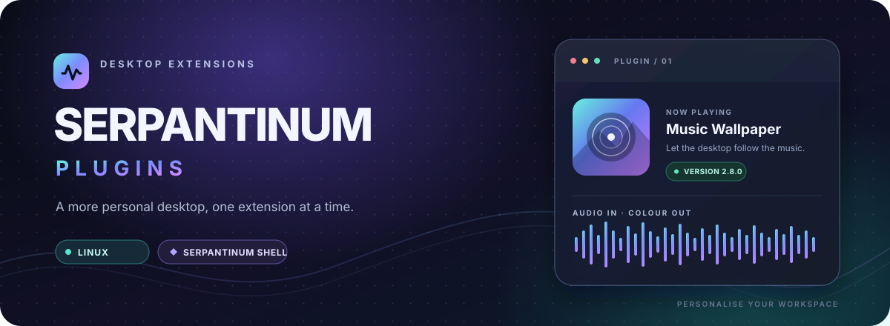

<div align="center">
  

  <br>

  <p>
    <a href="https://github.com/dimos0106-bot/SerpantinumPlugins"></a>
    <a href="https://github.com/ilyamiro/serpantinum"></a>
    <a href="https://github.com/dimos0106-bot/SerpantinumPlugins/commits/main"></a>
  </p>

  <p><strong>Small extensions. A desktop that feels like yours.</strong></p>
  <p>A growing collection of add-ons for <a href="https://github.com/ilyamiro/serpantinum">Serpantinum Shell</a>, built around personalisation, useful integrations, and a more coherent Linux desktop.</p>

  <p>
    <a href="#-plugin-library">Explore plugins</a> ·
    <a href="#-getting-started">Getting started</a> ·
    <a href="#-contributing">Contribute</a>
  </p>
</div>

---

## ✦ The idea

Serpantinum Plugins is a home for extensions that add focused features to your desktop without turning the shell into a different product. Each plugin should stay as self-contained as possible, document its own requirements, and fit naturally into Serpantinum's interface.

<table>
  <tr>
    <td width="33%" valign="top">
      <h3>◈ Modular</h3>
      Pick the extensions you need instead of installing one giant bundle.
    </td>
    <td width="33%" valign="top">
      <h3>⌘ Native-feeling</h3>
      Prefer Serpantinum's own settings, file pickers, and localisation where available.
    </td>
    <td width="33%" valign="top">
      <h3>↗ Evolving</h3>
      New plugins and improvements can be added independently as the collection grows.
    </td>
  </tr>
</table>

## 🧩 Plugin library

<table>
  <tr>
    <td width="76" align="center" valign="top">
      <div align="center">🎵</div>
    </td>
    <td valign="top">
      <h3><a href="plugins/music-wallpaper/README.md">Music Wallpaper</a></h3>
      <p><strong>v2.8.0</strong> · Serpantinum plugin</p>
      <p>Connect the visual mood of your desktop to the music you're playing. The plugin detects current media, searches a configured wallpaper folder for artwork-related matches, and provides its settings inside Serpantinum's Plugins tab.</p>
      <p>
        <code>Media detection</code>
        <code>Wallpaper matching</code>
        <code>Native folder picker</code>
        <code>Localisation</code>
      </p>
      <p><a href="plugins/music-wallpaper/README.md">Read plugin documentation →</a></p>
    </td>
  </tr>
  <tr>
    <td colspan="2">
      <sub>More plugins can be added to the collection. Compatibility, dependencies, and installation steps should be checked in each plugin's own documentation.</sub>
    </td>
  </tr>
</table>

## 🚀 Getting started

**1. Get the repository**

```bash
git clone https://github.com/dimos0106-bot/SerpantinumPlugins.git
cd SerpantinumPlugins
```

**2. Choose a plugin**

Open the plugin's directory and read its `README.md` before making changes to your system.

**3. Follow its instructions**

Every plugin can have different requirements. Use the installation and restart steps documented for that specific plugin; do not assume one command works for the entire collection.

> **Development status:** the collection is evolving. Check the plugin's supported Serpantinum revision and available package files before installing it. Keep a backup of relevant configuration.

## 🗂️ Repository layout

```text
SerpantinumPlugins/
├── assets/
│   └── serpantinum-hero.svg
├── plugins/
│   └── music-wallpaper/
│       └── README.md
└── README.md
```

The root README describes the collection; each plugin's own documentation should contain its specific features, compatibility notes, installation steps, and known limitations.

## 🌐 Localisation & integration

Where possible, plugins should follow the language selected in Serpantinum settings and reuse the shell's native UI components. This helps extensions feel like part of the desktop rather than separate applications.

## 🤝 Contributing

Ideas, bug reports, and improvements are welcome.

When reporting a problem, include:
- the plugin name and version;
- your Serpantinum version and relevant environment details;
- steps to reproduce the issue and relevant, **redacted** logs.

Keep personal tokens, private keys, and other sensitive information out of public reports.

## 📜 Licensing

No repository-wide licence has been selected yet. Unless a licence is added to the repository or to an individual plugin, do not assume that redistribution or reuse is permitted.

---

<div align="center">
  <p><strong>Make the desktop yours.</strong></p>
  <sub>Serpantinum Plugins · Project in development</sub>
</div>
